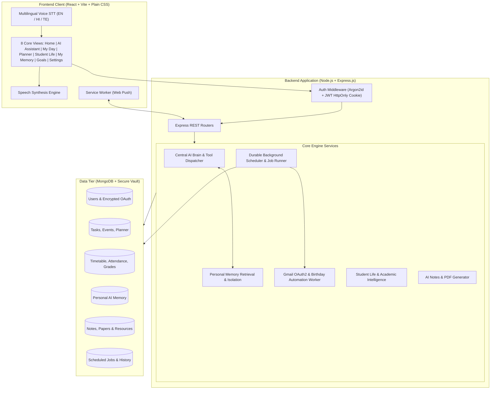

# LIFE OS — Master Product Specification & System Architecture

## 1. Executive Summary & Product Vision
LIFE OS is an enterprise-grade, privacy-first Personal Digital Life and Student Life Operating System. Designed for ordinary consumers and university students, it unifies fragmented digital routines, academic obligations, communication workflows, and contextual knowledge into a single conversational and graphical intelligence platform.

### Core Dual Verticals
1. **Personal Digital Life**: Communications (Gmail), Schedules (Google Calendar), Contact & Birthday automations, Tasks, Habits, Subscriptions/Bills, Personal Memory, Universal Capture, and Travel/Family coordination.
2. **Student Life**: Class timetables, real-time Attendance Intelligence, Assignment & Exam tracker, Academic Performance (configurable SGPA/CGPA), 12-section AI Academic Notes with PDF generation, Previous Year Question Papers intelligence, AI Study Buddy, and Career preparation (DSA, Internships, Projects).

---

## 2. Fixed Technology Stack Specification
- **Frontend**: React.js (v18+), Vite, Plain Modern CSS (Vanilla CSS variables, responsive grid/flexbox, custom design system, no Tailwind, no TypeScript).
- **Backend**: Node.js (v20+ / v26 compatible), Express.js (v4+), Native JavaScript (ESM modules), RESTful JSON APIs.
- **Database & Modeling**: MongoDB (v7+ running on localhost:27017 or Atlas), Mongoose (v8+).
- **AI Core**: Modular LLM Provider Adapter (Gemini API / Open-standard LLM fallback), structured function calling / tool dispatcher, memory retrieval vector & semantic scoring.
- **Voice Engine**: Multilingual Web Speech STT / Audio stream abstraction, multilingual TTS (English, Hindi `hi-IN`, Telugu `te-IN`), unified context pipeline.
- **Integrations**: Google OAuth 2.0 (`google-auth-library`), Gmail API (minimal `gmail.send` & `gmail.readonly`), Google Calendar API, Web Push API (`web-push`), Service Workers.
- **Validation**: Zod schema validation across all API boundaries.
- **Testing**: Vitest (Unit & Integration), Supertest (Express HTTP testing), Playwright (E2E browser testing).
- **Version Control & CI/CD**: Git, GitHub, GitHub Actions CI/CD.

---

## 3. System Architecture



---

## 4. Database Schema Design (MongoDB / Mongoose)

### 1. `users`
- `_id`: ObjectId
- `name`: String
- `email`: String (unique, indexed)
- `passwordHash`: String (Argon2id)
- `role`: String ('user', 'student')
- `timezone`: String (default: 'UTC')
- `preferredLanguage`: String ('en', 'hi', 'te')
- `googleAuth`:
  - `connected`: Boolean
  - `encryptedRefreshToken`: String (AES-256-GCM)
  - `scope`: [String]
  - `expiryDate`: Date
- `settings`:
  - `voiceEnabled`: Boolean
  - `autoSpeechOutput`: Boolean
  - `dailyBriefingTime`: String ("08:00")
  - `eveningRecapTime`: String ("20:00")
  - `attendanceTarget`: Number (default: 75)
- `createdAt`, `updatedAt`: Timestamps

### 2. `tasks`
- `userId`: ObjectId (indexed)
- `title`: String
- `description`: String
- `priority`: String ('low', 'medium', 'high', 'urgent')
- `status`: String ('pending', 'in_progress', 'completed', 'cancelled')
- `dueDate`: Date
- `reminderTime`: Date
- `isRecurring`: Boolean
- `recurrenceRule`: String (e.g. 'daily', 'weekly')
- `category`: String ('personal', 'academic', 'career', 'health', 'finance')
- `tags`: [String]
- `completedAt`: Date

### 3. `events` (Planner / Calendar)
- `userId`: ObjectId (indexed)
- `title`: String
- `description`: String
- `startTime`: Date (indexed)
- `endTime`: Date
- `allDay`: Boolean
- `location`: String
- `category`: String ('class', 'exam', 'personal', 'meeting', 'routine')
- `recurrence`: String
- `googleEventId`: String
- `syncStatus`: String ('local', 'synced')

### 4. `contacts` (Digital Life & Birthdays)
- `userId`: ObjectId (indexed)
- `name`: String
- `email`: String
- `phone`: String
- `relationship`: String ('family', 'friend', 'colleague', 'mentor')
- `birthday`: Date
- `preferredLanguage`: String ('en', 'hi', 'te')
- `messageStyle`: String ('friendly', 'emotional', 'heartfelt', 'funny', 'simple', 'personalized')
- `personalNotes`: String
- `autoBirthdayEmail`: Boolean
- `birthdaySendTime`: String ("09:00")
- `lastWishSentYear`: Number

### 5. `memories` (Personal AI Memory)
- `userId`: ObjectId (indexed)
- `category`: String ('preference', 'routine', 'relationship', 'personal_info', 'student_fact', 'idea')
- `content`: String
- `confidence`: Number
- `tags`: [String]
- `source`: String ('manual', 'chat_extracted', 'capture')
- `createdAt`, `updatedAt`: Timestamps

### 6. `student_profiles` & `timetables`
- `userId`: ObjectId (indexed)
- `university`: String
- `course`: String (e.g., 'B.Tech')
- `branch`: String (e.g., 'Computer Science')
- `semester`: Number
- `academicYear`: String
- `gradingSystem`: {
    type: String ('10-point', '4-point', 'percentage'),
    gradeMap: [{ letter: String, points: Number, minScore: Number }]
  }
- `timetable`: [{
    dayOfWeek: Number (1-7),
    subjectName: String,
    subjectCode: String,
    faculty: String,
    classroom: String,
    startTime: String ("09:00"),
    endTime: String ("10:00")
  }]

### 7. `attendance_records`
- `userId`: ObjectId (indexed)
- `subjectName`: String
- `subjectCode`: String
- `totalClasses`: Number
- `attendedClasses`: Number
- `sessions`: [{
    date: Date,
    status: String ('present', 'absent', 'cancelled'),
    remarks: String
  }]

### 8. `assignments_exams`
- `userId`: ObjectId (indexed)
- `type`: String ('assignment', 'exam', 'quiz', 'project')
- `title`: String
- `subjectName`: String
- `dueDate`: Date (indexed)
- `totalMarks`: Number
- `obtainedMarks`: Number
- `weightage`: Number
- `status`: String ('todo', 'submitted', 'graded')
- `syllabusUnits`: [String]

### 9. `academic_notes` & `exam_papers`
- `userId`: ObjectId (indexed, optional for public library)
- `type`: String ('ai_note', 'previous_paper')
- `subject`: String (indexed)
- `topic`: String
- `unit`: String
- `university`: String
- `semester`: Number
- `year`: Number
- `style`: String ('short', 'detailed', 'exam_oriented', 'beginner', 'revision')
- `structuredSections`: {
    introduction: String,
    definitions: [String],
    detailedExplanations: String,
    importantConcepts: [String],
    examples: [String],
    diagramsDescription: String,
    comparisonsTables: String,
    advantagesDisadvantages: String,
    applications: [String],
    examImportantPoints: [String],
    shortRevisionNotes: String,
    longAnswerExamPrep: String
  }
- `fileUrl`: String
- `isUserUploaded`: Boolean

### 10. `scheduled_jobs` & `notifications`
- `userId`: ObjectId (indexed)
- `jobType`: String ('birthday_email', 'class_reminder', 'task_reminder', 'daily_briefing', 'evening_recap')
- `targetDate`: Date (indexed)
- `status`: String ('pending', 'running', 'completed', 'failed', 'cancelled')
- `idempotencyKey`: String (unique)
- `payload`: mongoose.Schema.Types.Mixed
- `attempts`: Number
- `lastError`: String
- `deliveredAt`: Date

---

## 5. API Contract Specifications

### Auth & User (`/api/auth`)
- `POST /api/auth/register` -> `{ name, email, password }` => `201 { user, token }`
- `POST /api/auth/login` -> `{ email, password }` => `200 { user, token }`
- `GET /api/auth/me` -> Authenticated user profile
- `POST /api/auth/logout` -> Clear session cookie
- `PUT /api/auth/settings` -> Update user preferences

### AI Assistant & Voice (`/api/ai`)
- `POST /api/ai/chat` -> `{ message, conversationId, mode: 'chat'|'voice', language: 'en'|'hi'|'te' }` => `200 { reply, audioText, executedActions, suggestedQuickReplies, memoryRetrieved }`
- `POST /api/ai/preview-action` -> `{ actionName, params }` => `200 { preview, requiresConfirmation }`
- `POST /api/ai/confirm-action` -> `{ actionToken }` => `200 { success, result }`
- `GET /api/ai/conversations` -> Recent conversations list
- `GET /api/ai/briefing` -> AI Daily briefing & Evening recap

### Tasks & Planner (`/api/tasks`, `/api/planner`)
- `GET /api/tasks?date=YYYY-MM-DD&status=...`
- `POST /api/tasks` -> Create task with priority, category, reminders
- `PATCH /api/tasks/:id/toggle` -> Toggle completion status
- `DELETE /api/tasks/:id`
- `GET /api/planner/schedule?start=...&end=...` -> Merged daily timeline (tasks, classes, calendar events, focus sessions)
- `POST /api/planner/events` -> Create calendar event with conflict detection

### Student Life (`/api/student`)
- `GET /api/student/profile` -> University, branch, semester, target attendance
- `POST /api/student/profile` -> Update student configuration
- `GET /api/student/timetable` -> Weekday schedule
- `POST /api/student/timetable` -> Create/update class slots
- `GET /api/student/attendance` -> Subject-wise breakdown, % calculation, margin formulas:
  $$\text{Classes to reach target} = \max\left(0, \left\lceil \frac{\text{Target} \times T - 100 \times A}{100 - \text{Target}} \right\rceil\right)$$
  $$\text{Safe classes to miss} = \max\left(0, \left\lfloor \frac{100 \times A - \text{Target} \times T}{\text{Target}} \right\rfloor\right)$$
- `POST /api/student/attendance/log` -> Log present/absent for a subject session
- `GET /api/student/assignments` -> Assignment tracker
- `POST /api/student/assignments` -> Create assignment
- `GET /api/student/performance` -> SGPA / CGPA calculator with what-if simulator

### AI Academic Notes & Question Papers (`/api/academic`)
- `POST /api/academic/generate-notes` -> `{ subject, topic, unit, style: 'short'|'detailed'|'exam_oriented'|'beginner'|'revision', university }`
- `GET /api/academic/notes/:id` -> Full 12-section note
- `GET /api/academic/notes/:id/pdf` -> Download clean formatted PDF
- `GET /api/academic/question-papers?subject=...&semester=...&year=...` -> Search real repository of previous papers
- `POST /api/academic/question-papers/analyze` -> Repeated question pattern intelligence & high-yield topics
- `POST /api/academic/study-buddy/doubt` -> Subject-specific doubt solver with uploaded notes context

### Gmail & Birthday Automation (`/api/integrations/google`, `/api/contacts`)
- `GET /api/integrations/google/auth-url` -> Google OAuth URL with minimal scopes
- `GET /api/integrations/google/callback` -> Exchange auth code, encrypt token, store in DB
- `GET /api/contacts` -> Contacts list with birthday countdown
- `POST /api/contacts` -> Add contact with preferred language (EN/HI/TE) & style
- `POST /api/contacts/:id/generate-wish` -> AI birthday wish generation in chosen language & style
- `POST /api/contacts/:id/schedule-automation` -> Enable automatic yearly Gmail dispatch
- `GET /api/contacts/history` -> Delivery audit log with idempotency keys

### Personal Memory & Universal Capture (`/api/memory`, `/api/capture`)
- `GET /api/memory` -> Searchable memory items
- `POST /api/memory` -> Add manual memory
- `PUT /api/memory/:id` -> Edit memory
- `DELETE /api/memory/:id` -> Delete memory
- `POST /api/capture` -> Universal capture endpoint (text, voice note transcript, link, file meta) -> classifies into Task, Event, Reminder, Idea, Reference, Memory

---

## 6. UI Wireframes & 8 Navigation Sections Specification

```
+---------------------------------------------------------------------------------------+
|  [LIFE OS]   [Search / Quick Capture]              [Voice Mic] [Notifications] [User] |
+---------------+-----------------------------------------------------------------------+
| 1. Home       | GREETING: "Good morning, Akhil" | Mon, Nov 17, 2026                   |
| 2. AI Assist  | +-------------------------------------------------------------------+ |
| 3. My Day     | | AI DAILY BRIEFING: 3 urgent tasks, Next class: DBMS at 10:00 AM   | |
| 4. Planner    | +-------------------------------------------------------------------+ |
| 5. Student    | [Today's Timeline]          [Pending Tasks]     [Upcoming Birthdays]  |
| 6. My Memory  | - 10:00 AM: DBMS (Room 302) - Complete Assignment- Rahul (Tomorrow)  |
| 7. Goals      | - 02:00 PM: OS Lab          - Pay WiFi Bill     - Mom (Nov 24)        |
| 8. Settings   | [Attendance Alert] DBMS at 71% -> Attend next 2 classes to hit 75%    |
+---------------+-----------------------------------------------------------------------+
```

### Layout Specifications
- **Navigation Sidebar (Left)**: Fixed modern sleek dark/glass pane with clear icons and labels for all 8 primary sections:
  1. Home
  2. AI Assistant (Chat + Voice)
  3. My Day (Today's focus, active schedule, context tasks)
  4. Planner (Full calendar, recurring events, conflict visualizer)
  5. Student Life (Timetable, Attendance Intelligence, Notes, Question Papers, SGPA/CGPA, Study Buddy)
  6. My Memory (Isolated, inspectable knowledge store)
  7. Goals (Habits, routines, long-term personal & career aspirations)
  8. Settings (Google OAuth, Gmail send status, voice preference, language EN/HI/TE, theme)

---

## 7. Complete Feature Checklist

| # | Feature Domain | Requirement | Verification Method |
|---|----------------|-------------|---------------------|
| 1 | Navigation | 8 primary sections: Home, AI Assistant, My Day, Planner, Student Life, My Memory, Goals, Settings | Frontend Route & Layout Unit Test |
| 2 | Unified AI | Shared context between Chat and Multilingual Voice (EN/HI/TE) | Integrated AI Controller Test |
| 3 | AI Safety | Tool calling with authorization, action preview, sensitive confirmation | Tool Dispatcher Test Suite |
| 4 | My Day & Planner | Tasks, priorities, daily/weekly view, reminders, recurrence, conflict detection | Planner Service Vitest |
| 5 | Smart Notifications | Durable background scheduler, push notifications, snooze, idempotency | Queue & Notification Test |
| 6 | Personal Memory | Privacy isolation, inspectable, editable, deletable | Memory CRUD & Retrieval Test |
| 7 | Universal Capture | Text, voice, links, auto-classification into task/event/reminder/idea/memory | Capture Classification Engine Test |
| 8 | Birthday Gmail Automation | Contact management, multilingual wish generation (EN/HI/TE), OAuth 2.0 Gmail send, durable yearly cron, idempotency | Gmail Worker & Automation Test |
| 9 | Student Timetable | University, branch, semester, faculty, room, recurring slots | Student Module Integration Test |
| 10 | Attendance Intelligence | Accurate attendance %, classes needed for target, safe classes to miss, warning thresholds | Mathematical Formula Test Suite |
| 11 | Assignments & Exams | Deadlines, syllabus tracking, status | Assignment Controller Test |
| 12 | Academic Performance | Configurable SGPA/CGPA formula, semester credits, what-if calculator | GPA Calculation Unit Test |
| 13 | AI Academic Notes | 12-section structured notes, multiple styles, downloadable PDF | PDF & Note Generation Test |
| 14 | Question Papers Finder | Real search by subject/sem/year, repeated questions/topics pattern analysis | Academic Intelligence Test |
| 15 | AI Study Buddy | Doubt solver, flashcards, quizzes, study planner | Study Buddy Prompt & Endpoint Test |
| 16 | Career & Campus | Project tracking, DSA practice progress, internship tracker, budget | Career Module Routes Test |
| 17 | Security | Argon2id, HTTP-only cookies, per-user data isolation, Zod validation, token encryption | Security Audit & Auth Tests |
| 18 | Quality & CI/CD | Reusable React components, Express services/models, Vitest & Supertest, GitHub Actions | GitHub Actions Workflow & Test Run |

---

## 8. Development Roadmap & Execution Phases
- **Phase 0**: Requirements verification, repository inspection, master architecture & specifications.
- **Phase 1**: Architecture signoff, database models, wireframes implementation.
- **Phase 2**: Project scaffolding, Vite React frontend, Express backend, package configurations.
- **Phase 3**: Responsive modern UI design system (Plain CSS) and 8 Navigation Views.
- **Phase 4**: Backend models, controllers, routers, MongoDB connection.
- **Phase 5**: Authentication, Argon2id, JWT HTTP-only cookies, security middlewares.
- **Phase 6**: My Day, Tasks, and Planner with conflict detection.
- **Phase 7**: Durable background job scheduler & notification engine.
- **Phase 8**: Central AI Brain & tool dispatcher.
- **Phase 9**: Multilingual Speech-to-Text & Text-to-Speech (English, Hindi, Telugu).
- **Phase 10**: Personal Memory and Universal Capture.
- **Phase 11**: Digital Life features (Contacts, Subscriptions, Calendar).
- **Phase 12**: Automatic Birthday Gmail engine with OAuth2 and idempotent sending.
- **Phase 13**: Student Life (Timetable, Attendance intelligence, Assignments, SGPA/CGPA).
- **Phase 14**: AI 12-Section Academic Notes & Previous Exam Papers intelligence.
- **Phase 15**: AI Study Buddy & Career/Campus module.
- **Phase 16**: Goals, habits, routines, daily briefing and evening recap.
- **Phase 17**: Comprehensive testing (Unit, Integration, Security).
- **Phase 18**: GitHub repository initialization, commits, and CI/CD workflows.
- **Phase 19**: Production build and deployment verification.
